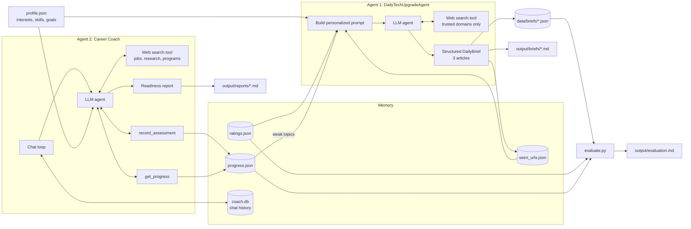

# Agentic AI Coworkers

Two personal AI agents built with the [OpenAI Agents SDK](https://openai.github.io/openai-agents-python/):

| Agent | File | What it produces |
|---|---|---|
| **DailyTechUpgradeAgent** | `daily_tech.py` | Daily top-3 technical articles brief (`output/briefs/`) |
| **nextLevelPersonalCoachForCareerLevel** | `coach.py` | Interactive coaching + Career Readiness Report (`output/reports/`) |

## 1. Agent Goals

**DailyTechUpgradeAgent: become a better technical learner every day.**
- Find 3 recent, high-quality articles from authoritative sources (OpenAI, Anthropic, Microsoft, Google, AWS, IBM, LangChain/LangGraph, IEEE, ACM, Hugging Face, arXiv).
- For each: title, source, date, URL, technical summary, key takeaways, and why it matters for *my* goals.
- Fit a 15-20 minute reading session.
- Personalize from my profile, my ratings of past briefs, and weak topics found by the career coach. Never repeat an article.

**nextLevelPersonalCoachForCareerLevel: prepare for my next career milestone.**
- Search for internships, jobs, research roles, and startup programs that match my profile, and compare their requirements to my skills.
- Interview me one question at a time (conceptual, coding, system design, behavioral), score each answer 1-5, give feedback, and push with follow-ups.
- Track scores by topic across sessions, identify strengths and gaps, recommend resources, and build a preparation plan.
- Generate a Career Readiness Report on demand.

## 2. Architecture



**Tools**
- Hosted web search (OpenAI Responses API). Agent 1 restricts it to `trusted_domains` in `profile.json`.
- `record_assessment(topic, question, score, feedback)` and `get_progress()`: Python function tools for the coach.

**Data sources**: the web (via search), `profile.json`, and my own answers and ratings.

**Memory**
- Short-term: the coach's chat history in a SQLite session (`data/coach.db`), which persists across runs.
- Long-term: `progress.json` (scores), `ratings.json` (article feedback), and `seen_urls.json` (no repeats).
- The agents share memory. Topics the coach scores below 3/5 steer what Agent 1 recommends next.

## 3. Running it

```bash
uv venv && uv pip install -r requirements.txt   # or: python -m venv .venv && pip install -r requirements.txt
cp .env.example .env                            # then add your OPENAI_API_KEY
```

Edit `profile.json` with your interests, skills, and target roles, then run:

```bash
python daily_tech.py                         # today's brief -> output/briefs/YYYY-MM-DD.md
python evaluate.py rate 2026-10-16 5 4 3     # rate the 3 articles (feeds personalization)
python coach.py                              # chat; /report, /progress, /reset, /quit
python evaluate.py                           # -> output/evaluation.md
```

To make Agent 1 actually daily, schedule it (macOS/Linux cron, 8am):
```
0 8 * * * cd /path/to/agentic-coworkers && .venv/bin/python daily_tech.py
```

## 4. Sample Results

- Daily briefs: [`output/briefs/`](output/briefs/)
- Coaching session transcripts: [`output/sessions/`](output/sessions/)
- Career Readiness Report: [`output/reports/`](output/reports/)

## 5. Evaluation

`evaluate.py` measures both agents and writes `output/evaluation.md`.

**Agent 1: accuracy (automatic)**
| Metric | How it's measured | Why |
|---|---|---|
| Link validity | HTTP request to every URL | LLMs can make up URLs |
| Freshness | Published date falls in the lookback window | Requirement is *recent* articles |
| Source authority | URL host is on the trusted-domain list | Requirement is *authoritative* sources |
| Novelty | URL never recommended before | Daily learning should be new |
| Format compliance | Exactly 3 articles per brief | Spec requirement |

**Agent 1: effectiveness (human)**: I rate each article 1-5 for usefulness. The average rating should rise over time as ratings feed back into recommendations.

**Agent 2: user progress**: every answer is scored 1-5 by topic. The evaluation shows each topic's first and latest score and compares the average of earlier answers to later ones. Rising scores on topics that were previously weak show the coaching is working.

**Agent 2: coaching quality (manual check)**: for a sample of answers, I check whether the score and feedback were fair, and whether any job postings it cited are real (their links load).

**Limitations**: an LLM grading the user's answers can be inconsistent. The agent is told not to inflate scores, and spot checks catch obvious errors, but scores are a signal rather than ground truth.
