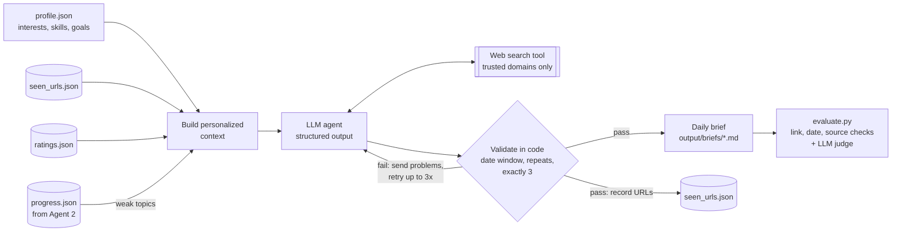
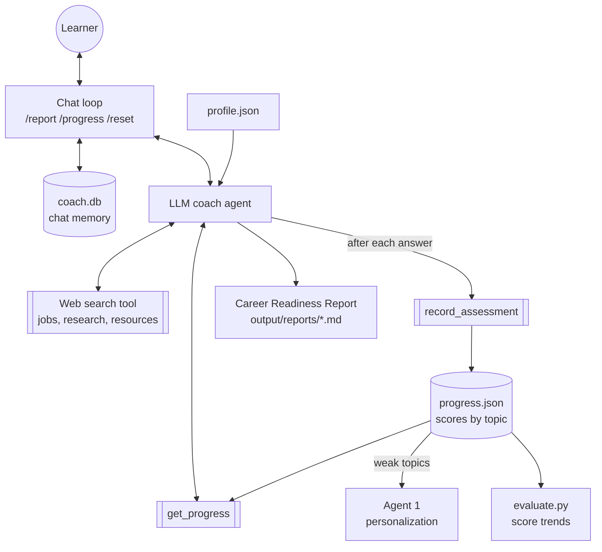

# Agentic AI Coworkers

**DailyTechUpgradeAgent** and **nextLevelPersonalCoachForCareerLevel**

Bernie Miao · CMPE 272, San José State University · October 16, 2026  
Source code: <https://github.com/EducatedBernie/agentic-ai-coworkers>

---

## 1. Agent Goals

### Agent 1: DailyTechUpgradeAgent
**Purpose:** help me become a better technical learner every day by doing the searching and filtering for me, so my reading time goes to high-value material.

**Expected outcomes**
- A daily brief of the **top 3** recent technical articles from authoritative sources: OpenAI, Anthropic, Microsoft, Google, AWS, IBM, LangChain/LangGraph, IEEE, ACM, Hugging Face, and arXiv.
- For each article: title, source, publication date, URL, a technical summary, three key takeaways, and an explanation of how it advances *my* knowledge and career goals.
- Total reading time of 15-20 minutes.
- Personalization that improves over time, using my profile, my ratings of past articles, and weak topics found by Agent 2. It never repeats an article.

### Agent 2: nextLevelPersonalCoachForCareerLevel
**Purpose:** prepare me for my next career milestone, a Summer 2027 AI/ML or AI-product engineering internship, while keeping an entrepreneurial path open.

**Expected outcomes**
- Relevant internships, jobs, research positions, and startup programs found by live web search, each with a skills gap analysis against my profile.
- Interactive interview practice: conceptual, coding, system design, and behavioral questions grounded in real job descriptions. The coach asks one question at a time, scores each answer 1-5, gives specific feedback, and asks follow-ups that push deeper.
- Strengths, knowledge gaps, recommended resources, and a week-by-week preparation plan.
- Progress tracked across sessions, plus a **Career Readiness Report** on demand.

---

## 2. Architecture

### Agent 1 architecture



### Agent 2 architecture



| Component | Implementation |
|---|---|
| Framework | OpenAI Agents SDK (Python) on the OpenAI Responses API |
| Agent 1 tools | Hosted web search, restricted to a trusted-domain allowlist |
| Agent 2 tools | Hosted web search; `record_assessment()` and `get_progress()` Python function tools |
| Data sources | Live web (engineering blogs, research sites, job boards), `profile.json`, my answers and ratings |
| Short-term memory | SQLite-backed conversation session (`data/coach.db`) that persists across coaching runs |
| Long-term memory | `progress.json` (scores by topic), `ratings.json` (article feedback), `seen_urls.json` (no repeats) |
| Shared memory | Topics Agent 2 scores below 3/5 are passed to Agent 1, which then picks articles on them |

### Agent 1 workflow
1. **Build context.** Load my profile, the last 100 recommended URLs, my recent ratings, and my weak topics from the coach's progress file.
2. **Search and select.** The agent searches trusted domains and returns a typed `DailyBrief` object (structured output) with exactly 3 articles.
3. **Validate in code.** Each date is parsed and checked against the lookback window, and every URL is checked against history. If anything fails, the specific problems are sent back to the agent, which supplies replacements (up to 3 attempts).
4. **Publish.** Save the Markdown brief and the raw JSON, and add the URLs to history.

### Agent 2 workflow
1. On startup the coach calls `get_progress()` and greets me with where I stand.
2. **Opportunities:** web search finds postings, and the coach compares their requirements with my skills.
3. **Drills:** the coach asks me a question, waits for my answer, evaluates it, calls `record_assessment()`, then asks a harder follow-up.
4. **`/report`:** the coach reads all progress data and writes the Career Readiness Report.

---

## 3. Working Prototype

I built the prototype in about 600 lines of Python across four files:

| File | Role |
|---|---|
| `daily_tech.py` | Agent 1. Domain-filtered search, structured output, validation-and-retry loop |
| `coach.py` | Agent 2. Interactive command-line chat with commands `/report`, `/progress`, `/reset`, `/quit` |
| `evaluate.py` | Automated accuracy checks, LLM-judge scoring, user ratings, progress trends |
| `common.py` | Shared paths, atomic JSON persistence, configuration |

```bash
pip install -r requirements.txt
cp .env.example .env               # add OPENAI_API_KEY
python daily_tech.py               # Agent 1: today's brief
python coach.py                    # Agent 2: interactive coaching
python evaluate.py judge           # LLM-judge scores for new briefs
python evaluate.py                 # evaluation report
```

To run Agent 1 every day, I schedule it with cron, e.g. `0 8 * * * .venv/bin/python daily_tech.py`.

**My design decisions**
- **I used structured output** (Pydantic models), which guarantees every brief has the required fields and gives the evaluator data it can parse.
- **I restricted search to trusted domains**, which makes source authority a hard limit the model cannot override.
- **I validate in code** rather than trusting the prompt. My first live run showed why: the model ignored the date window and returned a March 2026 article. The validation loop caught it and the agent replaced it.
- **I had the coach write scores through a tool call**, so my progress is structured data, not something buried in chat text.

---

## 4. Sample Results

Full outputs are in Appendices A-C and in the repository's `output/` folder.

### Daily technical recommendations (Oct 16, 2026)
Theme: *reliable agentic applications that combine efficient tool selection, trace-aware evaluation, and persistent memory.*

| # | Article | Source | Date |
|---|---|---|---|
| 1 | TRACER: Trajectory-Aware Tool Retrieval for LLM Agents | arXiv | 2026-10-15 |
| 2 | Four evaluation engineering lessons learned from building agent plugins | Google Cloud Blog | 2026-10-16 |
| 3 | How to implement long-term AI agent memory in AlloyDB and Memorystore for Valkey | Google Cloud Blog | 2026-10-02 |

### My interactive career coaching session
- **Opportunities found:** Google Forward Deployed Engineering Intern (Sunnyvale), DoorDash ML Intern, Master's (SF/Sunnyvale), and Veeam AI/ML Intern (San Jose), each with a skills gap analysis.
- **Drills I answered:** restaurant recommender system design (3/5), RAG support assistant design (3/5), combined recommender + RAG design (4/5), and a Python top-k coding problem (4/5).
- After each of my answers the coach gave concrete feedback and a harder follow-up. For example, after my RAG answer it pointed out that I missed hybrid search, reranking, citation verification, and prompt-injection defenses. I used those ideas in my next answer and scored higher.
- **My readiness report:** overall readiness 68/100, a gap list, linked resources, a 4-week plan, and a measurable milestone (ship a recommender with grounded RAG explanations by Nov 13, 2026).

---

## 5. Evaluation

### How I measure effectiveness, accuracy, and progress

| Dimension | Metric | Method |
|---|---|---|
| **Accuracy** (Agent 1) | Link validity | HTTP request to every URL, to catch made-up links |
| | Freshness | Published date is inside the 14-day window |
| | Source authority | URL host is on the trusted-domain allowlist |
| | Novelty | URL was never recommended before |
| | Format compliance | Exactly 3 articles per brief |
| **Effectiveness** (Agent 1) | Relevance, depth, actionability (1-5 each) | An independent LLM judge opens each article and scores it against my profile |
| | Usefulness (1-5) | My own rating per article (`evaluate.py rate`), which also feeds personalization |
| **My progress** (Agent 2) | Score per topic over time | First vs. latest score per topic, and early vs. late average across all answers |
| | Gap closure | Topics below 3/5 should rise after targeted reading and practice |
| **Coaching quality** (Agent 2) | Fair grading, real postings | I spot-check scores and check that cited job links load |

### Results (Oct 16, 2026)

| Metric | Result |
|---|---|
| Link loads | 100% (3/3) |
| Date within window (after validation) | 100% (3/3) |
| From trusted domain | 100% (3/3) |
| No repeats | 100% (3/3) |
| Exactly 3 articles | 100% (1/1) |
| LLM-judge relevance / depth / actionability | 5.0 / 4.0 / 4.0 out of 5 |
| My coach scores, first half vs. second half of answers | 3.0 → 4.0 |
| Cited job and resource links | Google and Built In postings and all checked resource links load; Indeed (DoorDash posting) blocks automated checks, so unverified |

### What I found
Running these checks on my first live outputs, I found two real defects and fixed both:
1. **Dates out of window.** Agent 1 returned a September and then a March article despite being told to use only the last 14 days, and it formatted dates inconsistently. I fixed it with code-side date parsing and the validate-and-replace loop. Freshness went from 2/3 to 3/3.
2. **Placeholder score.** Agent 2 recorded a 1/5 score when it *asked* a question, before any answer existed, which would have distorted the progress trend. I fixed it by tightening the tool and agent instructions, and I removed the bogus entry.

### Limitations
- I have one day of briefs so far and haven't added my own usefulness ratings yet, so the LLM judge measures effectiveness for now. Trends in ratings and novelty need several days of runs.
- An LLM grading my answers can be inconsistent. I told the coach not to inflate scores and I spot-check outliers, but scores are a signal, not ground truth.

---

## Appendix A: Daily Tech Brief (Oct 16, 2026)

<!-- include: ../output/briefs/2026-10-16.md -->
Full file: [output/briefs/2026-10-16.md](../output/briefs/2026-10-16.md)

## Appendix B: Coaching Session Transcript

<!-- include: ../output/sessions/2026-10-16_sample.md -->
Full file: [output/sessions/2026-10-16_sample.md](../output/sessions/2026-10-16_sample.md)

## Appendix C: Career Readiness Report

<!-- include: ../output/reports/readiness-2026-10-16.md -->
Full file: [output/reports/readiness-2026-10-16.md](../output/reports/readiness-2026-10-16.md)
